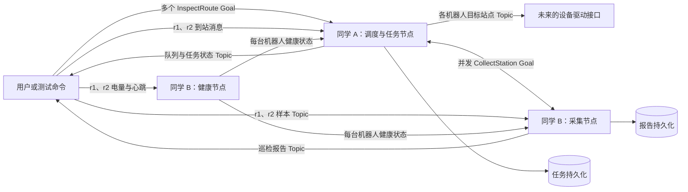

# ROS 2 双人巡检任务与数据采集系统：项目需求

> 版本：2.0（4 周地狱难度版）  
> 项目周期：4 周，建议每周每人投入 20～25 小时  
> 参与人数：2 人  
> 交付目标：可运行、可测试、可复现的 ROS 2 多节点系统

## 1. 项目背景与边界

本项目开发**多机器人巡检任务控制层**：接收多条巡检路线，按优先级排队，分配给两台机器人，并行采集各站点数据。运行中必须处理暂停、取消、截止时间、超时、异常数据、低电量和心跳中断；某台机器人失联后应把未完成的任务交给另一台可用机器人。节点重启后，任务不能无声丢失。

本阶段**不需要真实机器人、机器人模型、仿真器、建图或导航算法**。两台机器人只是协议中的 `r1`、`r2` 两个身份；目标站点发布到各自的命名空间。当前通过 ROS 2 命令或测试用例发送到站、采样、电量和心跳消息。测试用例不承担机器人运动仿真的职责。

项目重点是实际使用 ROS 2 的节点、Topic、Service、Action、参数、launch、QoS、日志与测试，并通过 Git 完成双人协作。

### 1.1 成功时的业务流程

1. 用户同时提交 `task-001: A → B → C` 和 `task-002: D → E`，分别设置优先级和截止时间。
2. 调度器检查站点、机器人健康状态与队列，给任务分配 `r1`、`r2`。
3. 任务节点向 `/robots/r1/target_station` 发布 `A`。收到与机器人、任务、站点都匹配的到站消息后，向采集 Action 发送目标。
4. 采集节点按任务和机器人分别收集样本，生成报告。两台机器人可同时处于采集阶段。
5. 若 `r1` 失联，调度器保留已完成报告，把当前未完成的站点重新分配给健康且空闲的 `r2`；没有可用机器人时等待或超时失败。
6. 用户通过各自 Action 的 feedback 查看排队位置、分配的机器人和站点进度，通过 result 得到最终结果。

### 1.2 不在本期范围内

- 机器人实际移动、定位、路径规划、摄像头识别和真实传感器驱动。
- 网页或手机界面；所有演示通过 ROS 2 接口完成。

## 2. 系统结构与职责



| 负责人 | 负责的包或节点 | 主要成果 |
|---|---|---|
| 同学 A | `mission_manager`、`task_scheduler`、站点配置 | 多任务调度、两个机器人并发执行、失联接管、任务持久化及恢复。 |
| 同学 B | `inspection_collector`、`health_monitor` | 双机器人并发采集、样本质量检查、逐机器人健康状态、报告持久化。 |
| 共同 | `inspection_interfaces`、`system_bringup`、集成测试 | 接口定义、launch、错误码、配置样例、端到端验收。 |

两个子系统都必须分别实现并讲解 **Topic、Service、Action 和参数**。接口包先由两人共同评审，之后各自开发对应节点。

## 3. 数据与接口约定

以下是第一版协议。实际 `.msg/.srv/.action` 文件以双方合并到仓库的版本为准；字段改名或改变语义必须更新本文档和调用方。

### 3.1 通用规则

- `task_id` 由提交任务的人生成，在持久化记录中唯一；同一个 ID 不能对应两条不同路线。重启后允许用同一 ID 和相同内容恢复未完成任务。
- `robot_id` 取站点配置中的机器人 ID，第一版固定为 `r1`、`r2`。机器人输入按 `/robots/<robot_id>/...` 命名，消息体仍需包含 `robot_id`，用于交叉校验。
- `station_id` 必须存在于站点配置中，大小写敏感；示例：`A`、`B`、`C`。
- 同一任务的站点列表不得重复；报告以 `task_id + station_id` 作为唯一键，避免接管和恢复时重复生成。
- 错误码用数字常量和文字说明共同表示。`0` 表示无错误。
- 到站和采样消息必须同时匹配**机器人 ID、任务 ID 与当前站点 ID**。旧任务、其他机器人、其他站点和重复样本都不能推进任务。
- 时间戳使用消息携带的 ROS 时间；超时判断使用节点接收时的时钟，并在测试中统一时间来源。
- 任务和报告状态应带简短 `detail`，便于命令行查看失败原因。

### 3.2 同学 A 设计并实现的 Topics

| Topic | 类型 | 方向 | 必要字段 / 规则 |
|---|---|---|---|
| `/robots/<robot_id>/target_station` | `inspection_interfaces/msg/TargetStation` | 发布 | `robot_id`、`task_id`、`station_id`、`station_index`、`station_count`、`active`。重新分配或终止任务时，先向原机器人发布 `active=false`。 |
| `/robots/<robot_id>/arrival` | `inspection_interfaces/msg/ArrivalEvent` | 订阅 | `robot_id`、`task_id`、`station_id`、`arrived_at`。命名空间、机器人 ID、任务和站点均须匹配。 |
| `/mission/status` | `inspection_interfaces/msg/MissionStatusArray` | 发布 | 包含所有未结束任务的状态快照；每项含 `task_id`、`robot_id`、阶段、队列位置、当前站点、完成数量、错误码和时间戳。 |
| `/mission/queue` | `inspection_interfaces/msg/QueueStatus` | 发布 | 按调度顺序列出待分配任务的 ID、优先级和位置；队列变化时发布。 |
| `/robots/<robot_id>/health/state` | `inspection_interfaces/msg/HealthState` | 订阅 | 按机器人分别保存健康状态；某台机器人故障不应暂停另一台的任务。 |
| `/inspection/availability` | `std_msgs/msg/Bool` | 订阅 | B 停用或不可用时暂停依赖采集的任务；长期没有反馈也应由超时检测到故障。 |

**建议 QoS：**目标和状态采用 reliable、transient local、深度 1；队列快照采用 reliable、transient local；到站事件采用 reliable、volatile。不能让旧的到站消息因持久化 QoS 在重启后被再次执行。实际实现时验证发布端与订阅端的 QoS 兼容性。

### 3.3 同学 A 设计并实现的 Services

| Service | 请求 | 响应与规则 |
|---|---|---|
| `/stations/get`，`GetStation.srv` | `station_id` | `found`、`name`、`description`。站点来自 YAML；不存在时 `found=false`。 |
| `/mission/set_pause`，`SetMissionPause.srv` | `task_id`、`pause` | 只暂停或继续指定任务。暂停采集中任务时联动 B；健康未恢复时不得继续。 |
| `/mission/get_state`，`GetMissionState.srv` | `task_id` | 返回该任务状态、分配的机器人、当前站点和错误原因。 |
| `/mission/get_queue`，`GetMissionQueue.srv` | 空请求 | 返回任务队列顺序及两台机器人的占用状态。 |

### 3.4 同学 A 设计并实现的 Action

`/mission/inspect_route`，类型 `inspection_interfaces/action/InspectRoute`：

| 部分 | 字段 | 要求 |
|---|---|---|
| Goal | `task_id`、`station_ids[]`、`priority`、`deadline`、`resume_existing` | 优先级为 `0～9`；截止时间为零表示无期限。多个 Goal 可被接受并排队；同一 ID 的恢复请求必须与原目标完全一致。 |
| Feedback | `state`、`robot_id`、`queue_position`、`current_station_id`、`current_index`、`completed_count`、`reassignment_count`、`detail` | 排队、分配、接管、进入新站点和等待期间均反馈。 |
| Result | `success`、`error_code`、`detail`、`reports[]`、`reassignment_count` | 包含已经完成的站点报告。成功、失败、取消要使用对应的 Action 终态。 |

收到符合条件的到站事件后，A 作为 Action 客户端调用 B 的 `/inspection/collect_station`。排队中的 Goal 也支持取消；用户取消活动任务时，A 必须取消子 Action、清除旧目标并释放机器人。A 不直接读取样本并计算报告。第一版最多有 2 条活动任务和 8 条排队任务。

### 3.5 同学 B 设计并实现的 Topics

| Topic | 类型 | 方向 | 必要字段 / 规则 |
|---|---|---|---|
| `/robots/<robot_id>/inspection/sample` | `inspection_interfaces/msg/InspectionSample` | 订阅 | `robot_id`、`task_id`、`station_id`、`sample_seq`、`temperature_c`、`vibration_rms`、`measured_at`。按机器人、任务、站点和序号去重。 |
| `/inspection/report` | `inspection_interfaces/msg/InspectionReport` | 发布 | `robot_id`、`task_id`、`station_id`、样本数、平均温度、最大振动值、`passed`、错误码和详情。每次完成采集后发布一次。 |
| `/robots/<robot_id>/battery_state` | `sensor_msgs/msg/BatteryState` | 订阅 | 使用 `percentage`，范围为 `0.0～1.0`；值无效时该机器人健康状态为 `UNKNOWN`。 |
| `/robots/<robot_id>/heartbeat` | `std_msgs/msg/Empty` | 订阅 | 分别记录每台机器人的最后心跳到达时间。 |
| `/robots/<robot_id>/health/state` | `inspection_interfaces/msg/HealthState` | 发布 | `robot_id`、`level`、`battery_percentage`、`battery_ok`、`heartbeat_ok`、`detail`、`stamp`。 |
| `/robots/<robot_id>/health/state` | `inspection_interfaces/msg/HealthState` | 订阅 | `inspection_collector` 只暂停故障机器人的活动采集。 |
| `/inspection/availability` | `std_msgs/msg/Bool` | 发布 | 采集节点激活后发布 `true`，停用前发布 `false`；可靠并保留最新值。 |

**建议 QoS：**采样采用传感器数据 QoS；报告和健康状态采用 reliable、transient local、深度 1。命令行测试时注意使用兼容的 QoS 设置。

### 3.6 同学 B 设计并实现的 Services

| Service | 请求 | 响应与规则 |
|---|---|---|
| `/inspection/get_report`，`GetInspectionReport.srv` | `task_id`、`station_id` | 从持久化记录查询；未完成或不存在时返回明确原因。 |
| `/inspection/set_pause`，`SetInspectionPause.srv` | `task_id`、`station_id`、`pause` | 只影响指定采集。暂停时保留已收样本，不计入采样超时；健康异常时拒绝继续。 |
| `/health/reset_alarm`，`ResetRobotAlarm.srv` | `robot_id` | 该机器人的电量和心跳恢复后才允许清除告警；不影响其他机器人。 |
| `/health/get_robot_state`，`GetRobotHealth.srv` | `robot_id` | 返回该机器人的电量、心跳、告警和最近更新时间。 |

### 3.7 同学 B 设计并实现的 Action

`/inspection/collect_station`，类型 `inspection_interfaces/action/CollectStation`：

| 部分 | 字段 | 要求 |
|---|---|---|
| Goal | `robot_id`、`task_id`、`station_id` | 每台机器人至多一个活动采集目标；两台机器人可同时采集。故障机器人不可接新目标。 |
| Feedback | `accepted_samples`、`rejected_samples`、`required_samples`、`elapsed_sec`、`detail` | 每收到有效或无效样本、暂停或恢复时反馈。 |
| Result | `success`、`error_code`、`detail`、`report` | 样本数达到要求时完成并写入持久化报告；样本超时则失败。 |

`success=true` 表示**采集流程完成**，不代表巡检数据合格；是否合格由 `report.passed` 表示。数据不合格时，A 根据 `allow_skip_failed_station` 决定继续或结束总任务。允许跳过时，最终 Action 可成功结束，但结果中的该站报告仍必须保持 `passed=false`。取消采集时不得发布“已完成”的报告。

## 4. 调度、容错与节点运行规则

### 4.1 确定性的多任务调度

- 同时最多运行两条任务，每台机器人最多执行一条；最多再排队八条任务。队列满时拒绝新 Goal。
- 待分配任务先按 `priority` 从高到低排序，再按 `deadline` 从早到晚排序，最后按进入队列时间和 `task_id` 排序。零截止时间排在有截止时间的任务之后。
- 从健康且空闲的机器人中选择电量较高者；电量相同选字典序较小的 `robot_id`。高优先级任务可插入队列前方，但不抢占已运行的任务。
- 排队或运行时超过截止时间，任务结束为 `FAILED`，不能继续占用机器人。队列位置、机器人分配或任务阶段变化时立即更新 `/mission/status` 和 Action feedback。
- 队列取消只删除指定 Goal；活动任务取消须取消 B 的子 Goal、清除目标并释放机器人。取消、超时和故障同时发生时，对同一任务只能产生一个终态和一份最终结果。

### 4.2 任务状态、暂停和接管

状态包括 `QUEUED`、`WAITING_FOR_ROBOT`、`WAITING_ARRIVAL`、`COLLECTING`、`PAUSED_MANUAL`、`PAUSED_HEALTH`、`PAUSED_DEPENDENCY`、`RECOVERY_REQUIRED`、`SUCCEEDED`、`CANCELED`、`FAILED`。每个任务独立保存状态、已完成报告、当前机器人和当前站点。

人工暂停和健康暂停分别记录原因；两者同时存在时，解除其中一种不能恢复任务。暂停期间到站与采样超时计时停止，截止时间仍然有效，健康监控继续运行。B 收到健康故障后应自行暂停该机器人的采集；A 也要暂停对应任务并调用 B 的暂停服务，重复调用必须安全。故障输入恢复后，先复位告警，再由用户显式继续；继续采集前 A 要确认 B 的继续服务成功。

一台机器人低电量或失联时，A 向其发布 `active=false` 的旧目标，取消该机器人未完成的采集 Goal，保留已完成的站点报告。当前未完成的站点在新机器人上**从头采集**。若另一台健康且空闲，立即重新分配；否则进入 `WAITING_FOR_ROBOT`，等待至 `robot_recovery_timeout_sec`。接管次数超过上限则失败。故障机器人恢复后不能自行继续旧任务。

如果任务同时处于人工暂停状态，可以更新分配和清除故障机器人的旧目标，但新机器人在人工暂停解除前不能收到 `active=true` 的目标。

### 4.3 每台机器人的健康状态

启动后，在收到该机器人有效电量和至少一次心跳前为 `UNKNOWN`。电量低于阈值为 `LOW_BATTERY`；心跳超过阈值未到达为 `HEARTBEAT_LOST`。如果两种故障同时存在，`battery_ok`、`heartbeat_ok` 和 `detail` 要能表达两者。告警锁存：输入恢复不会自动把状态改为 `NORMAL`，须按机器人 ID 调用 `/health/reset_alarm`。故障机器人不可接受新任务或新采集 Goal，另一台机器人正常工作。

### 4.4 采样质量与并发隔离

- 两台机器人可同时执行 `/inspection/collect_station`；每个 Goal 独立保存样本集合、暂停状态和超时计时。
- `sample_seq` 重复、站点或任务不匹配、数值为 NaN/无穷大、时间戳过旧的样本均不计入结果，但要增加 `rejected_samples` 计数并给出原因。
- 有效样本数达到要求后计算平均温度与最大振动值。报告先持久化，再发布 Topic 和 Action result；同一 `task_id + station_id` 只能有一份完成报告。
- `success=true` 表示采集完成，不等于数据合格。`allow_skip_failed_station=true` 时可继续下一站；最终任务成功表示路线执行完毕，失败站点仍须在 `reports[]` 中保持 `passed=false`。
- 两位开发者都要处理 ROS 2 回调并发：等待 Action 结果或样本时，心跳、取消、查询 Service 和另一台机器人的 Goal 仍须得到响应。不得用阻塞循环让单个回调占满执行器。

### 4.5 节点生命周期与重启恢复

A 的 `mission_manager` 与 B 的 `inspection_collector` 都应是 ROS 2 生命周期节点。`configure` 时加载配置和本地记录，`activate` 后才接受 Action Goal；`deactivate` 时停止接收新 Goal，保存未结束状态并清除活动目标。launch 按“健康节点 → 采集节点 → 任务节点”的顺序启动和激活。B 在停用前发布 `/inspection/availability=false`；意外退出时 A 通过反馈/可用性超时进入 `PAUSED_DEPENDENCY`。B 重新激活后，A 查询已完成报告，再由用户显式继续。健康节点可使用普通节点。

A 和 B 分别使用本地 SQLite 文件保存任务状态与完成报告。每次状态迁移或报告完成后提交事务。进程异常退出再启动时，A 将原先未结束的任务标记为 `RECOVERY_REQUIRED`，不自动发布新目标；B 丢弃未完成的采样缓存，但保留完成报告。用户用**相同任务 ID、相同 Goal 内容且 `resume_existing=true`** 重新发送 Action Goal 后，A 查询 B 的报告，跳过已完成站点，从第一个未完成站点继续。内容不一致的恢复请求必须拒绝。

旧 Action 客户端连接不会被当作已恢复。恢复后的新 Goal 获得新的 Action 会话，原会话不得导致重复目标或重复报告。

### 4.6 参数文件示例

| 节点 | 参数 | 初始值 | 含义 |
|---|---|---:|---|
| A | `arrival_timeout_sec` | `30.0` | 等待到站的最长有效运行时间。 |
| A | `robot_recovery_timeout_sec` | `20.0` | 无可用机器人时最长等待时间。 |
| A | `dependency_timeout_sec` | `5.0` | 采集 Action 无反馈或不可用的判定时间。 |
| A | `max_reassignments` | `2` | 单任务最多接管次数。 |
| A | `max_pending_tasks` | `8` | 排队任务上限。 |
| A | `max_stations_per_task` | `10` | 单任务最大站点数。 |
| A | `allow_skip_failed_station` | `false` | 数据不合格时是否继续。 |
| A | `feedback_period_sec` | `1.0` | Action feedback 周期。 |
| B | `required_sample_count` | `3` | 单站有效样本数。 |
| B | `sample_timeout_sec` | `20.0` | 采样最长有效运行时间。 |
| B | `sample_max_age_sec` | `5.0` | 样本可接受的最大年龄。 |
| B | `max_temperature_c` | `40.0` | 平均温度报警阈值。 |
| B | `max_vibration_rms` | `3.0` | 最大振动值报警阈值。 |
| B | `min_battery_percentage` | `0.20` | 机器人最低允许电量。 |
| B | `heartbeat_timeout_sec` | `3.0` | 心跳中断判定时间。 |

超时、数量和队列上限必须大于零，电量阈值必须在 `0.0～1.0` 之间。非法配置应阻止生命周期节点进入 `Active`，并在日志中指出参数。A、B 各至少支持一个参数运行时修改，使用参数回调拒绝非法值；已经开始的采集沿用 Goal 启动时的阈值，新值只作用于后续 Goal。

### 4.7 错误码清单

| 代码 | 含义 | 主要产生方 |
|---:|---|---|
| `0` | 无错误 | A、B |
| `101` | Goal 无效，例如未知站点 | A |
| `102` | 队列已满或任务 ID 冲突 | A |
| `103` | 到站或机器人恢复超时 | A |
| `104` | 子 Action 不可用 | A |
| `105` | 截止时间已过 | A |
| `106` | 接管次数超限 | A |
| `107` | 恢复请求与持久化任务不一致 | A |
| `108` | 采集节点不可用或停用 | A |
| `201` | 有效样本不足或采样超时 | B |
| `202` | 温度或振动超限 | B 的报告 |
| `203` | 报告持久化失败 | B |
| `301` | 电量过低 | B 健康节点 |
| `302` | 心跳中断 | B 健康节点 |

取消使用 ROS 2 Action 的取消终态；结果 `detail` 要写明发生时的机器人、站点和阶段。同一代码不能在 A、B 中表示不同问题。

## 5. Git 仓库与协作约定

建议目录结构：

```text
src/
  inspection_interfaces/  # 双方共同维护的 msg、srv、action
  mission_core/           # 同学 A：任务、队列、接管和恢复
  inspection_core/        # 同学 B：采集、健康、报告
  system_bringup/         # launch、机器人/站点 YAML、参数 YAML
test/                     # 集成测试与验收脚本
docs/                     # 架构、接口和演示说明
README.md
```

- `main` 始终保持可构建、可运行；每项功能建立 issue 和独立分支，通过 Pull Request 合并。
- 另一位同学必须审查 Pull Request。审查至少检查接口兼容性、异常路径、运行方法与测试结果。
- 修改 `.msg/.srv/.action`、参数名或状态码时，同一个 Pull Request 中同步更新调用方和文档；跨人的修改先在 issue 中约定。
- 每周末交换演示：A 运行并解释 B 的采集流程，B 运行并解释 A 的任务流程。
- 每个 Pull Request 附上可复现命令或自动化用例；合并前执行构建、接口检查和相关测试。
- 不提交 `build/`、`install/`、`log/`、运行时 SQLite 文件、临时 rosbag 和机器专属配置。最终验收录包作为单独交付物保存。

## 6. 4 周里程碑

| 周次 | 同学 A 交付 | 同学 B 交付 | 共同检查点 |
|---|---|---|---|
| 第 1 周 | 定义任务状态、队列排序和机器人分配；实现站点/队列查询、目标与状态快照 Topic、生命周期节点骨架。 | 定义并发采集与健康状态；实现两组命名空间输入、健康监控、报告 Topic、生命周期节点骨架。 | 合并全部接口、机器人配置和 launch；两台机器人分别显示健康状态，双方互审接口。 |
| 第 2 周 | 完成并发 `InspectRoute` Goal、优先级队列、双机器人分配、到站匹配与反馈。 | 完成双机器人并发 `CollectStation` Goal、样本隔离、报告查询与统计。 | 同时完成两条三站任务，第三条排队；验证优先级、截止时间和取消。 |
| 第 3 周 | 完成健康故障接管、等待可用机器人、暂停/继续、接管上限。 | 完成低电量与失联锁存、告警复位、采集暂停、样本质量拒绝。 | 故障只影响所属机器人；当前站点在新机器人重做，已完成报告不重复。 |
| 第 4 周 | 完成任务持久化、重启恢复、运行时参数验证与竞争条件测试。 | 完成报告持久化、重启后查询、运行时参数验证与竞争条件测试。 | 从干净环境构建，跑完全部验收用例，录包复盘并完成文档。 |

## 7. 验收场景与通过标准

测试输入使用 `ros2 action send_goal`、`ros2 topic pub`、`ros2 service call`，或由自动化测试直接向相同接口发送消息。不需要持续运行的机器人或仿真节点。两台机器人的输入应使用不同命名空间，测试脚本必须可重复运行。

| 编号 | 场景 | 预期结果 |
|---|---|---|
| T1 | `r1`、`r2` 都健康；同时提交两条三站任务并输入各自的到站和样本。 | 两条 Action 并行成功，报告各 3 份且机器人 ID 正确。 |
| T2 | 两台机器人忙时提交三条不同优先级、截止时间的任务。 | 队列顺序严格符合第 4.1 节；机器人空闲后按顺序分配。 |
| T3 | 提交超过 8 条排队任务、空路线、未知站点或冲突任务 ID。 | 对应 Goal 被拒绝；已有任务和队列不受影响。 |
| T4 | 在 `r2` 命名空间发布携带 `r1` ID 的到站消息，以及错误任务、错误站点和重复消息。 | 全部被忽略并记录原因；任务不越站。 |
| T5 | 两台机器人同时采样，交错发送正确、重复、过期、NaN 和错站样本。 | 两个 Action 的计数与报告互不污染，拒收数量及原因正确。 |
| T6 | 一个站点样本不足直到超时；另一个站点温度或振动超限。 | 超时任务失败；超限报告为 `passed=false`，跳过策略的两种取值都正确。 |
| T7 | `r1` 活动任务中停止发送心跳，`r2` 空闲且健康。 | `r1` 目标清除，`r2` 接管当前站点；已完成报告保留，未完成采样从头开始。 |
| T8 | `r1` 低电量且 `r2` 忙碌，之后 `r2` 空闲或恢复等待超时。 | 任务先进入 `WAITING_FOR_ROBOT`，随后接管或按时失败；`r2` 原任务不受影响。 |
| T9 | 采集中人工暂停，再触发健康故障；只解除其中一种暂停原因。 | 任务仍暂停；两种原因均解除后才能继续，已收样本保留。 |
| T10 | 取消排队任务、活动任务、暂停任务，并同时触发超时。 | 每个任务只产生一个终态；子 Action 取消，机器人释放，无新目标或重复报告。 |
| T11 | 活动任务超过截止时间；排队任务在分配前超过截止时间。 | 两者均以截止时间错误结束，不继续占用或获得机器人。 |
| T12 | 活动采集中异常结束 B 的进程并重启。 | A 进入 `PAUSED_DEPENDENCY`；已完成报告仍可查询，未完成样本不冒充完成报告；B 恢复后可继续。 |
| T13 | 活动任务中异常结束 A 的进程并重启，再提交相同 ID 的恢复 Goal。 | 恢复前不自动发目标；恢复后从首个未完成站点继续，无重复报告；不一致 Goal 被拒绝。 |
| T14 | 将 A 或 B 生命周期节点切换为 `Inactive`，然后发送新 Goal。 | 新 Goal 不执行；已活动任务被安全暂停并记录。重新激活后按恢复规则处理。 |
| T15 | 分别修改 A、B 的合法运行时参数，再写入非法值。 | 合法值影响后续 Goal；非法值被拒绝且原值保留；进行中的 Goal 不被中途改写阈值。 |
| T16 | 在节点运行后才启动状态订阅者，并录制一次失联接管过程。 | 订阅者取得两台机器人和所有未结束任务的最新状态；rosbag 与日志能解释接管顺序。 |
| T17 | 两台机器人持续采样时，同时调用状态查询、取消、告警复位和参数修改接口。 | 两条采集 Action 均持续反馈；服务和取消请求能够响应，无回调死锁。 |

**最终交付：**源码、接口定义、机器人/站点/参数 YAML、launch 文件、README、架构图、上述 17 个验收场景的运行记录、一次失联接管过程的 rosbag，以及任务和报告持久化格式说明。两位同学各自完成 Topic、Service、Action、参数及生命周期节点的设计与实现，并能解释对方模块的调用关系。

## 8. 第一周即可开始的任务

1. 两人共同确定 ROS 2 发行版、编程语言、机器人和站点 ID，以及所有接口字段和错误码。
2. 先创建 `inspection_interfaces` 包，让全部自定义消息、服务和 Action 成功构建。
3. A 写出队列排序、接管、恢复的状态表，并实现 `/mission/status` 快照发布。
4. B 写出两台机器人健康状态与采样隔离的状态表，并实现两组电量、心跳订阅。
5. 两人各提交一个 Pull Request，互审接口和状态表，从干净工作区重新构建。

## 9. 技术参考

- [ROS 2 Action 设计](https://design.ros2.org/articles/actions.html)：用于 Goal、feedback、result、多 Goal 和取消的接口设计。
- [ROS 2 托管节点生命周期设计](https://design.ros2.org/articles/node_lifecycle.html)：用于配置、激活、停用与恢复的状态约定。
